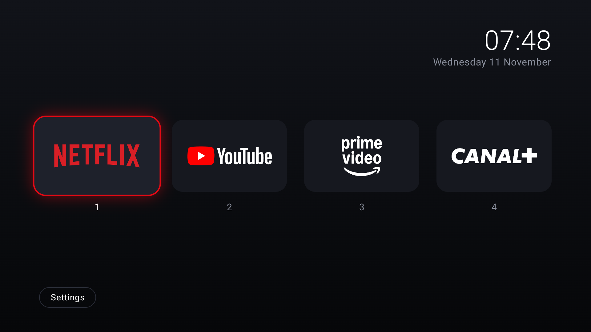
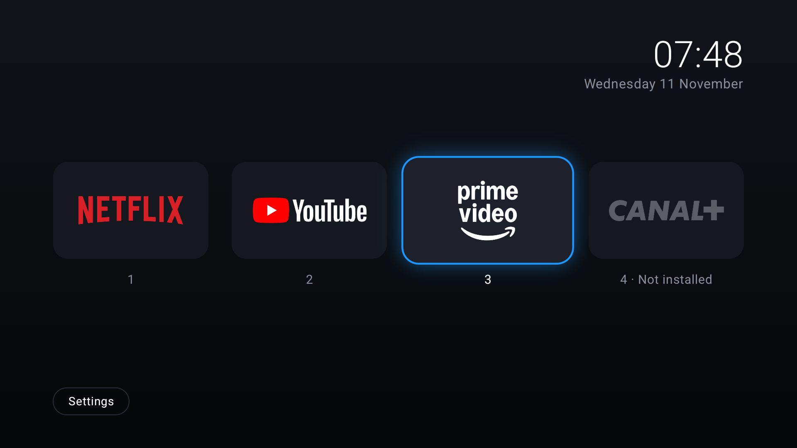

# CapITV

**One box, one remote, four apps, on both TVs.**

CapITV turns a certified Google TV / Android TV box into a quiet appliance that does
exactly four things: **Netflix, YouTube, Prime Video, Canal+**. No feeds, no
recommendations, no ads on the home screen, nothing that phones home, and the same
layout and remote in the living room (LG, webOS) and the bedroom (Samsung, Tizen).

<p align="center">
  
</p>

## Why not a Raspberry Pi?

Netflix, Prime Video and Canal+ only give HD/4K/HDR to **certified devices with
hardware DRM (Widevine L1)**. A Raspberry Pi only ever gets software Widevine L3,
whatever OS you put on it: Netflix tops out at 1080p in a browser, Prime Video
drops to SD, and Canal+ doesn't support it at all. Details and sources in
[docs/HARDWARE.md](docs/HARDWARE.md#why-not-a-raspberry-pi). So the "own OS" part is
a certified box, **locked down**: CapITV replaces its home screen and switches the rest off.

## What's in the repo

| Path | What |
|---|---|
| [`launcher/`](launcher) | The CapITV launcher, a native Android TV app (Kotlin, Compose for TV). 4 logo tiles + clock + Settings. **No INTERNET permission**, no analytics, no network code. Config in [`capitv.json`](launcher/app/src/main/assets/capitv.json), bundled so both TVs are identical. |
| [`provision/`](provision) | `capitv-provision.sh <box-ip>`: one idempotent adb script that installs the launcher, makes it the Home screen, disables bloat from a reviewed list, sets Private DNS, and can undo all of it with `--restore`. |
| [`docs/`](docs) | [Hardware](docs/HARDWARE.md) · [Remote](docs/REMOTE.md) · [TV setup](docs/TV-SETUP.md) · [Supervision checklist](docs/SUPERVISION.md) · [Signing](docs/SIGNING.md) · [Original brief](docs/BRIEF.md) |

## The home screen

One logo per tile, and under it the remote key that opens it. The focused tile glows in its
app's colour. An app that isn't installed (or is disabled) is faded out; selecting it opens
its Play Store page. Logos live in [`assets/logos/`](launcher/app/src/main/assets/logos) and are set per tile in `capitv.json`.

<p align="center">
  
</p>

<sub>Screenshots: Google TV 14 emulator at 1080p, release build.</sub>

## Architecture

```
 LG / Samsung TV  (offline, smart features off, CEC on)
      ▲ HDMI 1 + CEC (power, input switching)
      │
 Google TV Streamer 4K  ◀── Streamer Voice Remote (BT + IR: TV power/volume)
  ├─ CapITV launcher          home screen: 4 tiles, keys 1–4, colour keys
  │   └─ HomeKeyService       Home button → CapITV (Google TV has no "default launcher" setting)
  ├─ Netflix · YouTube/SmartTube · Prime Video · Canal+   (official, Widevine L1)
  ├─ Private DNS → NextDNS (or Pi-hole on the LAN)        ads + telemetry blocked
  └─ Everything else: disabled (reversible), never uninstalled
```

- **Remote:** the Streamer remote's Netflix and YouTube buttons and its custom
  star button work from anywhere, system-wide. CapITV adds 1–4, colour keys and the
  tiles. See [docs/REMOTE.md](docs/REMOTE.md).
- **Home button on Google TV:** Google TV ignores "default launcher". The stock launcher
  stays installed (so casting and the remote's app buttons keep working) and CapITV's
  tiny accessibility service answers the Home key. It only watches that one key and can't read the screen.
  `--hard-home` removes the stock launcher completely, at the cost of casting.
  On a Shield or plain Android TV, CapITV is set as the real default home.
- **Supported boxes:** Google TV Streamer 4K (default target), Chromecast with
  Google TV, Nvidia Shield TV (Android 11), any Android TV 11+ box with Widevine L1.

## Quick start (per TV, about 30 minutes)

1. **Buy** two Google TV Streamers (169 € each) and HDMI cables: [docs/HARDWARE.md](docs/HARDWARE.md).
2. **TV settings:** CEC on, auto input on, tracking/ads/auto-update off, TV offline: [docs/TV-SETUP.md](docs/TV-SETUP.md).
3. **Plug** the Streamer into **HDMI 1** on both TVs (Ethernet if you can), and set it up with the Google Home app.
4. **Box:** Settings > Accounts & Profiles > your profile > **Apps only mode: on**.
5. **Install** Netflix, YouTube, Prime Video and Canal+ from the Play Store and sign in to each (Canal+ uses a code at androidtv.canalplus.com).
6. **Remote:** Settings > Remotes & Accessories: set up **TV power, volume and input** for the LG/Samsung, and set the **star button to Prime Video**.
7. **Developer mode:** Settings > System > About > click **Android TV OS build** 7 times; then Settings > System > Developer options > **USB debugging** on (and **Wireless debugging** on the Streamer).
8. **On your Mac** (same Wi-Fi): `brew install android-platform-tools gh`, `gh auth login`, `git clone` this repo.
9. **Run:** `provision/capitv-provision.sh --smarttube --dns <id>.dns.nextdns.io <box-ip>` and accept the "Allow debugging?" prompt on the TV (tick *Always*).
10. **Test with the TV off:** press Netflix on the remote: the TV wakes, switches to HDMI 1 and Netflix opens. Press Home: CapITV. Repeat on the other TV and you're done.

`--dry-run` shows every change first; `--restore` undoes everything. Full list of
what needs your hands vs what an agent can do: [docs/SUPERVISION.md](docs/SUPERVISION.md).

## Build

```sh
(cd launcher && ./gradlew assembleRelease test lint)   # JDK 17, Android SDK 36
provision/tests/test-provision.sh                       # script tests against a fake adb
```

CI (GitHub Actions) runs the same, plus shellcheck and an APK permission check, and
publishes `capitv-<version>.apk` on every `v*` tag. The workflow is in [`ci/`](ci) until
it's enabled (one command, see [ci/README.md](ci/README.md)). Signing: [docs/SIGNING.md](docs/SIGNING.md).

## Privacy

- The launcher has **no INTERNET permission** (CI fails the build if one appears), no
  analytics and no crash reporting. Backups are switched off, and the only thing it stores is the bundled config.
- The four streaming apps still talk to their own services, and Google TV still
  needs a Google account (use a dedicated "TV" account). Private DNS blocks the rest.
- The repo is **private**. It can be made public with no changes, since there are no secrets in it.
